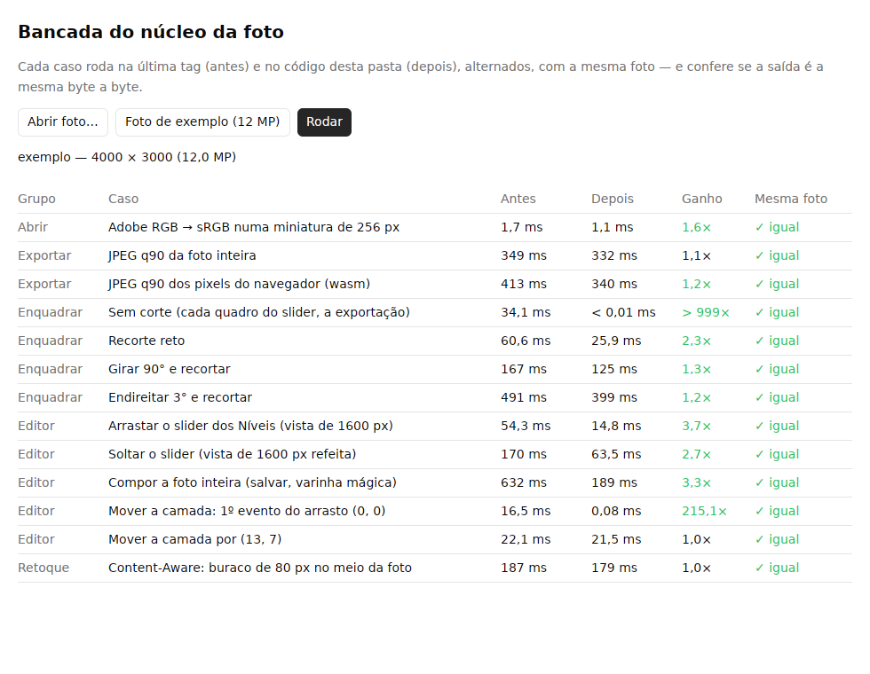

# Bancada

Uma janela para conferir, com uma foto sua, que o núcleo desta pasta é mais rápido que a última
tag, e que a foto que sai continua a mesma byte a byte.



```sh
make bancada                 # da raiz do repositório: abre a janela
make bancada-testar          # os testes da bancada (casos e janela, sem tela)

# ou, daqui:
cargo run --release                           # a janela
cargo run --release -- --sem-janela foto.cr3  # a mesma tabela, no terminal
```

Na janela:

1. **Abrir foto…** (JPEG, PNG, WebP, TIFF ou RAW) ou **Foto de exemplo (12 MP)**.
2. **Rodar**. Os casos rodam um a um, fora da thread da tela, e cada linha se preenche quando o
   caso dela termina.

| Coluna | O que é |
|---|---|
| Antes | Mediana do caminho na **última tag** (`v0.1.2`). |
| Depois | Mediana do caminho **nesta pasta**. |
| Ganho | Antes ÷ depois. Verde a partir de 1,1×, vermelho até 0,9×. |
| Mesma foto | ✓ quando as duas saídas são iguais byte a byte. ✗ é quebra de comportamento. |

Antes e depois rodam **alternados**: se a máquina esquenta ou se ocupa no meio, os dois lados
sentem igual. Os casos de RAW (revelar, procurar o XMP) só aparecem com um RAW aberto.

## Por que ela fica fora do workspace do núcleo

Os quatro apps consomem o núcleo por git com tag. A janela traz o GPUI e mais algumas centenas de
crates, que não podem entrar no grafo deles, no `Cargo.lock` do núcleo nem no `make verificar`.
Por isso a bancada tem o próprio `[workspace]` e o próprio `Cargo.lock`, e o `Cargo.toml` da raiz
a lista em `exclude`.

## Comparar com outra versão

O "antes" são os crates `*-antes` do `Cargo.toml`, presos numa tag. Para medir contra outra
versão, troque a tag nas quatro linhas e rode `cargo update`. Uma tag publicada nunca muda, então
a comparação é reproduzível.

## Pôr um caso novo

Cada caso é uma função em `src/casos.rs` que roda os dois lados com `medir::comparar` e diz se a
saída é a mesma. Quem mexe num caminho quente do núcleo põe o caso dele aqui, junto do
`cargo bench` do crate. O teste `todo_caso_sai_igual_na_tag_e_aqui` roda todos os casos numa foto
pequena: um caso que muda a foto não passa.

No Linux, a janela pede `libxkbcommon-dev`, `libxkbcommon-x11-dev`, `libxcb1-dev`,
`libfreetype-dev`, `libfontconfig-dev` e `libwayland-dev`. No macOS e no Windows não precisa de
nada além do Rust.
